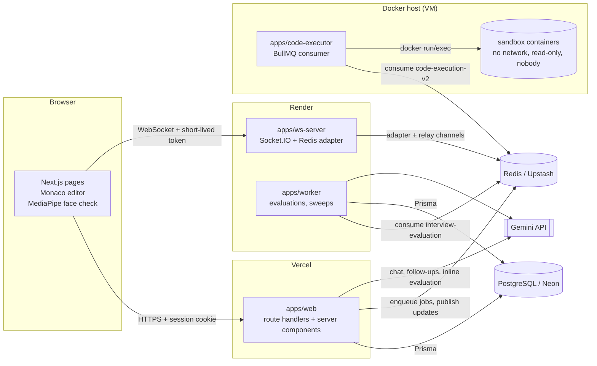
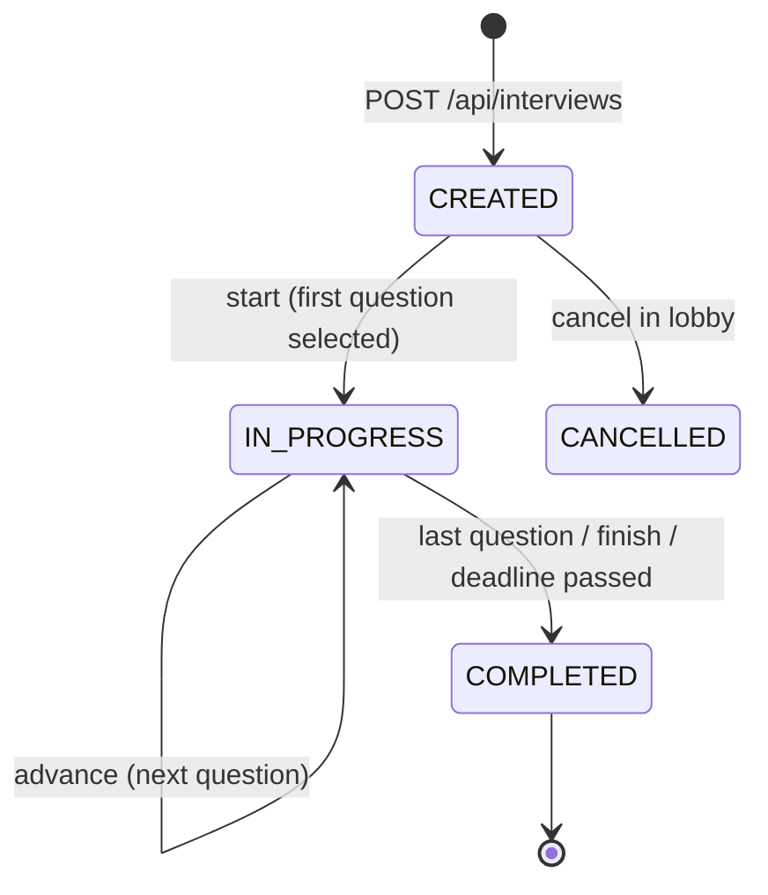
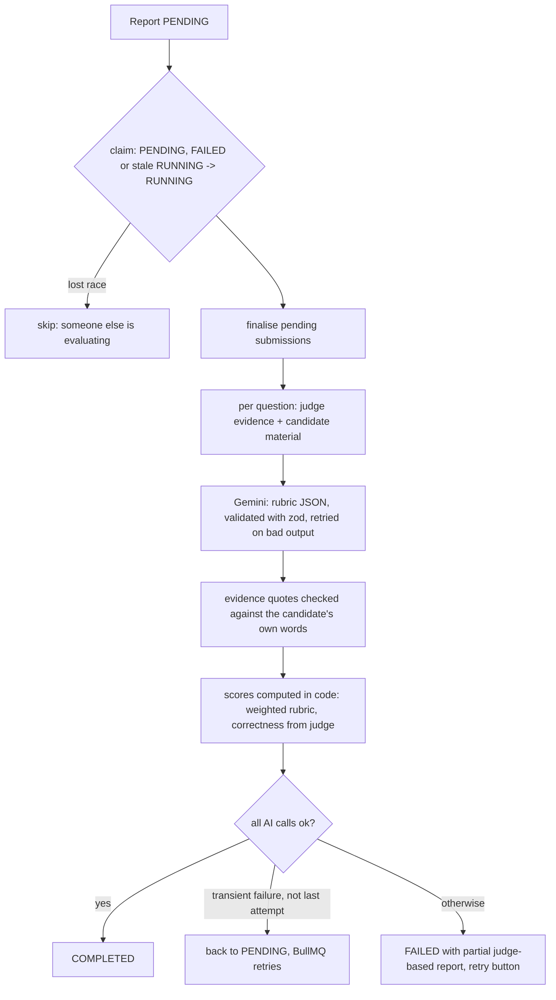

# Architecture

InterviewAI is a pnpm + Turborepo monorepo with four deployable services and four shared packages.



## Services

| Service | Responsibility | Holds | Never holds |
| --- | --- | --- | --- |
| `apps/web` | Pages, all HTTP APIs, authorization, question selection, submissions, chat, proctoring ingestion, inline evaluations | DB, Redis, AI key, Auth secrets, realtime signing secret | Candidate code execution |
| `apps/ws-server` | Authenticated Socket.IO rooms, presence, relaying sanitised updates, live code mirroring | Redis, realtime verification secret | DB credentials, AI keys, tests |
| `apps/code-executor` | Runs candidate code in hardened containers and returns verdicts | Redis only | DB credentials, AI keys, Auth secrets |
| `apps/worker` | Background AI evaluations (bounded retries), expiring overdue interviews, recovering stuck evaluations | DB, Redis, AI key | Candidate code execution |

Shared packages:

| Package | Contents | Where it may be imported |
| --- | --- | --- |
| `@repo/core` | Types, codec, comparators, harness generators, judge contracts, lifecycle, adaptive policy, rubrics and scoring, proctoring rules, realtime tokens, logger | Anywhere. `realtime`, `redis` and `observability` subpaths are server-only |
| `@repo/problem-bank` | 52 curated problems with hidden tests and reference solutions, technical and behavioral banks | Server only (web re-exports it behind `server-only`) |
| `@repo/engine` | Service layer used by web routes and the worker: interviews, submissions, chat, evaluation, proctoring, analytics, resumes | Server only |
| `@repo/database` | Prisma schema, migrations and client | Server only |

Node services are bundled with esbuild (`scripts/bundle.mjs`): workspace TypeScript packages are compiled in, npm dependencies stay external.

## Interview lifecycle



* Transitions are conditional updates (`WHERE status = ... AND version = ...`), so two tabs or a double click can never apply the same transition twice; `version` increments on every change and is broadcast to clients.
* The deadline (`endsAt`) is enforced on the server: any read after the deadline (plus a 30 s grace) completes the interview, and the worker sweeps overdue interviews every minute.
* Completing an interview creates the report row in `PENDING` and schedules evaluation exactly once.

## DSA question flow

```mermaid
sequenceDiagram
  participant B as Browser
  participant W as Web API
  participant R as Redis/BullMQ
  participant E as Executor
  participant S as Sandbox
  B->>W: POST /start
  W->>W: adaptive policy picks difficulty/topic, problem bank picks a problem
  W-->>B: statement, examples, starter code (no hidden tests)
  B->>W: POST /submissions {kind: SUBMIT, code, idempotencyKey}
  W->>W: auth, ownership, size/rate limits, executor heartbeat
  W->>R: add job (jobId = submissionId) with harness files + all tests
  R->>E: job
  E->>S: create container, write files, compile, run each test with timeout
  E->>R: return value (per-test verdicts; stdout only for visible tests), scrub hidden data from job
  E->>R: publish submission-updates:<room>
  R-->>B: (via ws-server) submission-event
  B->>W: GET /submissions/:id
  W->>R: read job result, persist sanitised result (conditional update)
  W-->>B: verdict, passed/total, visible output only
  B->>W: POST /follow-up {trigger: submission}
  W-->>B: one follow-up question based on the verified verdict
```

The judge harness is generated per language from the problem's typed signature: the candidate writes only the function, a hidden `main` reads the arguments from stdin, calls it and prints the return value in a canonical form, and the executor compares that text with the expected output (exact, unordered or float-tolerant). Compiler and runtime errors keep the candidate's line numbers (`#line` in C/C++, a separate `solution.*` file in Python/JS, imports sharing line 1 in Java).

AI-generated problems are optional. The model must return a problem in the same typed format plus a Python reference solution; the reference is run against every test in the sandbox, it must reproduce the examples the model claimed, and the hidden expected outputs come from that sandboxed run. Anything that fails falls back to a verified bank problem, and the reason is shown to the candidate.

## Redis and BullMQ

| Key / queue / channel | Producer | Consumer | Purpose |
| --- | --- | --- | --- |
| `code-execution-v2` queue | web (and AI problem validation) | code-executor | Judge jobs. `jobId = submissionId` makes enqueueing idempotent. 2 attempts on infrastructure errors. Results kept 24 h. |
| `interview-evaluation` queue | web | worker | One job per evaluation attempt (`eval-<room>-<n>`), 3 attempts with exponential backoff from 30 s. |
| `code-executor:heartbeat` | executor (30 s, TTL 90 s) | web, ws-server | Lets the UI say "judge offline" instead of hanging. |
| `evaluation-worker:heartbeat` | worker | web | `EVALUATION_MODE=auto` falls back to inline evaluation without it. |
| `interview-updates:<room>` | web | ws-server | Sanitised state/submission/evaluation notifications (contain only ids, status and version). |
| `submission-updates:<room>` | executor | ws-server | "submission finished" notifications. |
| `code-sync:<room>` | ws-server | ws-server | Latest candidate code snapshot for interviewers who join later (TTL 2 h). |
| `rl:<rule>:<subject>:<window>` | web | web | Fixed-window rate limits (in-memory fallback if Redis is down). |
| Socket.IO adapter channels | ws-server | ws-server | Room broadcasts across instances. |

Job state machine (BullMQ): `waiting -> active -> completed | failed`, with `delayed` between retry attempts. Submissions mirror it in PostgreSQL: `QUEUED -> RUNNING -> COMPLETED | FAILED`. Finalisation is a conditional update (`WHERE status IN (QUEUED, RUNNING)`), so concurrent readers cannot store a result twice, and a job whose record vanished from Redis is failed after 10 minutes with a "run again" message.

## Evaluation pipeline



* Rubrics per kind (`@repo/core/evaluation`): coding uses correctness (from the judge only), problem solving, algorithm choice, complexity analysis, edge cases, code quality and communication; technical and behavioral (STAR) have their own dimensions. The rubric version and model id are stored with every report.
* Candidate text, code and resume content are wrapped in `<untrusted>` blocks with an instruction to treat them as data. Hidden tests and reference solutions are never put into any prompt.
* Totals are weighted means computed in code; the model cannot inflate them, and dimensions without evidence are shown as "n/a" rather than guessed.

## Realtime and reconnection

* The browser asks the web app for a 15-minute HS256 token (`POST /api/interviews/:id/realtime-token`) after the server checked membership in PostgreSQL. The ws-server verifies the signature and expiry and joins the socket to the one room named in the token; there is no client-chosen `join-room`.
* Every reconnection fetches a fresh token and then refetches authoritative state from `GET /api/interviews/:id`. Socket messages only say "something changed" (with a version number); clients ignore versions older than what they have, so duplicate or out-of-order events are harmless.
* If the socket is unavailable the page polls (every 8 s, and every 1.5 s for pending submissions), so nothing depends on the socket for correctness.
* Drafts autosave every 1.5 s of inactivity, and proctoring events are queued in `localStorage` and flushed with `sendBeacon` on page hide, so a refresh or a crash loses neither code nor events. An open "tab hidden" interval is closed on the next load and marked `recoveredAfterReload`.
* The shared timer is computed from the server's `endsAt` corrected for clock skew (server time from the API and from the socket `hello`).

### Collaboration

Interviewers join with an invite link (`/interview/join/<token>`, the token is stored only as a SHA-256 hash) and get a read-only live view of the candidate's editor via `code-sync` messages, plus the question, chat history and, after the interview, the report and proctoring timeline with review controls. True multi-cursor co-editing is not implemented: the assessment is that it should be done with Yjs (`yjs` + `y-monaco` + a Socket.IO provider that relays updates and persists snapshots), not a custom merge algorithm. It was left out because a one-writer interview does not need it and the y-monaco/CDN-loaded Monaco combination needs care to avoid loading two Monaco instances.

## Code-execution security model

See [SECURITY.md](./SECURITY.md#code-execution) for the full list. In short: the web server never executes candidate code; the executor host holds only Redis credentials; each submission runs in a fresh container with no network, a read-only root filesystem, small `tmpfs` scratch space, a non-root user, all capabilities dropped, `no-new-privileges`, memory/CPU/PID/file-size/file-descriptor limits, a per-test `timeout -s KILL`, an outer watchdog, forced removal, and a self-destruct `sleep` as PID 1. Optional gVisor (`SANDBOX_RUNTIME=runsc`) adds a user-space kernel.

## Data model (PostgreSQL)

`User`, `Account`, `Session` (Auth.js) · `InterviewRoom` (lifecycle, settings, version, evaluation status) · `InterviewParticipant` (candidate / interviewer) · `InterviewQuestion` (per position; problem reference, selection reason, server-only rubric hints, answer, explanation, draft) · `Submission` (idempotency key, status, verdict, sanitised results) · `InterviewEvent` (chat, follow-ups, state changes) · `InterviewReport` (scores, per-dimension results with evidence, rubric version, model, integrity summary, attempts) · `ProctoringEvent` (one table for all signal types, server severity, review status, unique per client event id) · `GeneratedProblem` (validated or rejected AI problems with their tests) · `ResumeProfile` (structured, reviewed profile; no file or raw text).
